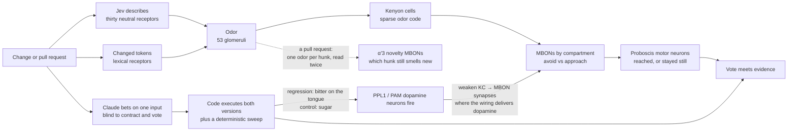

# fly-review

**Real fly wiring. Questionable judgment. Executable evidence.**

Would you merge code reviewed by a fruit fly?

fly-review gives a connectome-based neural simulation a vote on a code change, then teaches it from executed test outcomes the way a fly is taught: with a taste. It has **176,422 simulated neurons**, a real mushroom body, and no training except what executed tests give it: 126 lessons from a corpus whose labels were proven by running the code, plus whatever you teach it on the page. Jev describes the change with thirty neutral questions; the description and the changed tokens become an odor. Then an independent investigator, shown neither the spec nor the vote, bets on one input, and ordinary code executes it. If it reproduces a regression, the fly tastes bitter while it smells the change; if a designated harmless control holds, it tastes sugar. Its own dopamine neurons fire, and the synapses that weaken are the ones the connectome puts under them. Its approval is its behavior: when a smell alone makes its proboscis motor neurons fire, the fly reached for it.

**Jev describes. The fly smells, tastes, and remembers. Tests check, and teach.** Bring a bundled example, paste a change, or point it at a real GitHub pull request, which the fly reads hunk by hunk and looks at the hunk that smells unlike the rest.

Three things this README says plainly because they are true. As a classifier of one change, the fly is a little worse than a thirty-weight logistic regression on held-out cases and clearly worse on the hand-written ones; you could replace it. The brain earns its place two other ways, both measured below with the cases where they fail: novelty, a second circuit that reads a diff hunk by hunk and finds the one thing unlike the rest, when the rest are alike; and wiring. Rewire which dopamine neuron reaches which output neuron, degrees preserved, teach the rewired fly the same 126 lessons, and it catches zero of fifteen regressions and reaches for eleven of them. Rewire which Kenyon cell reaches which output neuron and nothing changes. The review depends on one particular part of the fly’s wiring, the dopamine map, and not on our encoding alone. The description Jev gives still carries most of the judgment: “smells like a refactor” is the cue the fly learned to trust, and a regression on the same thirty answers gets there without a brain.

[Run it](#run-it) · [Bring your own pull request](#bring-your-own-pull-request) · [What the fly actually does](#what-the-fly-actually-does) · [What is real and what is ours](#what-is-real-and-what-is-ours)

## The 30-second version

> Jev reads a code change and answers thirty descriptive questions about it. Those answers, and the tokens that changed, become an odor. The odor runs through a simulation built from real fruit-fly wiring. Then a separate AI, shown neither the contract nor the verdict, bets on one input, and code executes it against both versions. If it reproduces a regression, the fly tastes bitter while it smells the change; its punishment dopamine neurons fire and weaken the synapses the wiring puts under them. If a known-harmless control holds, it tastes sugar. The fly doesn’t understand TypeScript. It remembers what it tasted with a smell, and when a smell alone makes its proboscis come out, that is its approval. Give it a pull request and it reads hunk by hunk; every smell it is exposed to gets a little more familiar, so whatever still smells new on the second reading is where it looks.



## Run it

Requires **Node.js 24+**. Live Jev needs a [TypeSafe](https://docs.typesafe.ai/) key; the investigator needs an [Anthropic](https://console.anthropic.com/) key. Pull requests need nothing for public repos, and `GITHUB_TOKEN` or a logged-in `gh` for private ones and for posting.

```sh
npm install
npm run setup
test -f .env || cp .env.example .env   # then add your keys
npm run demo
```

Open **http://localhost:4488**.

0. New here? **Walk me through it** (top right, or open the page at `/#tour`) runs an interactive walkthrough on the real page: it swoops onto the mushroom body, shows Jev sniffing, the smell waking memory cells, two MBON teams pulling on the vote, the zap and the treat, and waits for you to ask the fly for real. Measured values are distinguished from clearly labeled illustrative numbers.
1. Choose a change and click **Ask the fly**. Jev describes it, the description becomes an odor, and 176,422 neurons run for 450 ms of simulated time. A fly that has learned nothing abstains.
2. Watch the recorded activity play back in 3D. The six ringed cells are the readout neurons. The fly in the corner is a lit, procedural 3D model (ellipsoids and tapered tubes at the animal’s proportions, faceted compound eyes, banded cuticle, veined translucent wings; a layered drawing if WebGL is missing) and shows what their firing does to the animal: MN9 extends its proboscis, DNg62 makes it groom, DNp01 raises its wings to jump. It reacts within a frame of each 25 ms bin. Click it to poke it. The vote is stamped on the diff when the bins finish.
3. Click **Was the fly right?** to run the investigation. A reproduced regression punishes the fly for this smell; a designated control rewards it. Then **Ask the fly again**: same change, same description, same seed; compare the new measured vote. **Forget everything** resets current memory, not the displayed recording. Ask again to measure the naive fly; a lesson is not a guarantee of a verdict change. **Ask another fly** gives a different seed the same memory.

Setup verifies and downloads the ~23 MB connectome, compiles the Java bridge, and exports the anatomy. It uses an existing JDK 21+ or downloads a project-local one on macOS/Linux arm64/x64. Nothing is installed globally. The simulation runs on your CPU; the browser uses WebGL with a 2D fallback. Turn **Sound on** for the spike crackle driven by the recorded bins, a ping per readout population, and the stamp.

| Action | What it costs |
|---|---|
| Ask the fly | One Jev request, then a local simulation (about 2 s) |
| Was the fly right? | One Anthropic request, then local code execution |
| Ask another fly | Nothing. Same description, new seed, new simulation |
| Fetch or post a pull request | GitHub API calls, unauthenticated for public repos |
| Replay, disconnect, rerun saved signals, tests, calibration | Nothing |

Defaults are `jev-latest` and `claude-haiku-4-5`; override with `TYPESAFE_MODEL` and `ANTHROPIC_MODEL`. `PORT` changes the port. Set `FLY_REVIEW_DATA_DIR` to a separate directory (for example `.runs/verification`) when running a second server, so its memory, record, and evidence are isolated. Without a TypeSafe key, live Jev is off; you can explicitly select **manual inputs** inside **Inspect this experiment**, which still runs the real simulation and is labeled as human-set. Nothing is silently mocked.

## Bring your own pull request

Pick **Review a GitHub pull request…**, paste a URL like `https://github.com/owner/repo/pull/123` (or `owner/repo#123`), and click **Fetch**. The page shows the title, description, and the whole diff, file after file with a sticky header per file, exactly as the encoder will see it. Then **Ask the fly**.

- The pull request is split at its `@@` hunks (up to 32; past that, whole files are the units, and past 32 files the largest 32). Jev describes **each hunk on its own**, with the title and description as context, within a **60 KB budget** (12 KB per file). Lockfiles and build output are listed by name with the patch omitted, as are binaries and renames without content changes. Each file header says whether its patch was shown or why it was not, and the same list is saved in the evidence bundle.
- The fly **reads the hunks in order, then reads them again**. Each reading makes a smell more familiar (see *Where it looks*); on the second, frozen reading, the hunk whose novelty MBONs stay loudest is the one it looked at. Its rows are tinted on the diff and marked; the list under the vote gives every hunk's novelty and avoidance share and scrolls to it on click. **The vote shown is its vote on that hunk.** A second opinion or a recall reuses the saved per-hunk descriptions and reads the whole diff again.
- **Nothing in the pull request is executed.** There is no contract, so there is no test: the fly votes and the vote stands untested. The bundled examples are where the vote is put on trial.
- Live Jev on a pasted change or a pull request shows the exact payload that would leave this machine (code and context, to api.typesafe.ai) and asks first. Cancel and choose manual inputs to keep the code local.
- With `GITHUB_TOKEN` or a logged-in `gh`, **Post the fly’s review to GitHub** leaves a comment-only review on the pull request: which hunk it looked at and why, the vote on that hunk, what Jev noticed, the mushroom body rates, how much memory the fly has, and a plain statement of what this is and isn’t. It asks first. It never approves or requests changes at the GitHub level.
- Private repositories work with a token that can read them.

You can also paste a single before/after file under **Paste your own change…**. Same rules: a vote, no test.

## What the fly actually does

**The nose is Jev.** Thirty descriptive questions, each a neutral yes/no property of the change (“changes a comparison operator”, “interpolates a parameter into a string”, “renames only”, “touches credentials”, …), each answered as a probability and each mapped to one olfactory glomerulus. None of them asks whether the change is good. The remaining 23 glomeruli are lexical receptors: the identifiers and operators in the changed lines, hashed, with the background of keywords and punctuation adapted out. The result is an odor: a pattern of rates over the fly’s 53 glomeruli. The same description always produces the same odor, and similar changes smell similar. Jev’s descriptions of the same change wobble slightly between calls (measured on one example, three calls: at most 0.14 on one receptor, 93 to 96% of the same Kenyon cells, vote share 0.515 to 0.519), so **Ask the fly again** freezes the description and only the memory can differ.

**The odor code.** Each glomerulus’s projection neurons synapse onto a specific subset of the 4,064 Kenyon cells in the real wiring. The odor’s weighted input picks the 5% of Kenyon cells it drives hardest within each class (αβ, α′β′, γ), standing in for the APL neuron’s inhibition and giving every lobe a code. Two unrelated odors share about 1% of their cells; two odors sharing a glomerulus share about 40%. (The simplified antennal lobe in this LIF model saturates, so this stage is computed from the connectome rather than simulated; everything downstream is simulated.)

**The memory is in the compartments the wiring defines.** Kenyon cells synapse onto the mushroom body output neurons (MBONs) through 31,493 plastic synapses. Which MBONs count as *avoid* and which as *approach* is read from the connectome, not assigned by us: each compartment’s valence is set by the dopamine neurons that innervate it (Aso et al. 2014), so the 36 MBONs that receive more of their dopamine from PPL1 cells (the ones punishment recruits) drive approach, the 48 that receive more from PAM cells (the ones reward recruits) drive avoidance, and 4 α′3 MBONs carry novelty and no valence. The words are the literature’s; which cell wears which word is the wiring’s.

**A lesson is a taste, and the fly’s own dopamine neurons do the teaching.** After a reproduced regression, the same odor is presented again with bitter on the proboscis; after a designated harmless control, with sugar. The 16 PPL1 cells (bitter) or the 316 PAM cells (sugar) fire, and inside that run, every 5 ms, a KC → MBON synapse is weakened if its Kenyon cell has fired in the last 100 ms *and* the dopamine neurons the connectome wires onto that MBON fired this tick, by an amount proportional to how much of that MBON’s dopamine input they are. Which synapses can change, and by how much of the rate, is anatomy: PPL1 axons end on the approach compartments, so bitter weakens the odor’s pull toward approach; PAM axons end on the avoidance compartments, so sugar weakens its push toward avoidance. The rule never consults the readout labels. Two honest footnotes. The taste pathways into the dopamine neurons are incomplete in this model (sugar never fires PAM through the wiring, and bitter fires only some PPL1 cells), so each taste is paired with direct drive of its dopamine family at 200 Hz, disclosed in every receipt. And the form and rate of the plasticity rule are ours; the connectome has no synapse-level plasticity to read. What moved out of our hands is which synapses a lesson can touch, and how much dopamine each one sees.

**The vote is behavior first.** A naive fly never extends its proboscis to an odor. A fly that has tasted sugar with a smell does: the proboscis motor neurons (MN9) fire to the smell alone, 30 to 36 Hz, through the fly’s own MBON-to-motor wiring, and that is its approval. Objection has no motor expression in this model (the odor of a punished change silences the approach MBONs, but nothing downstream of them reaches the legs or wings at these intensities), so an objection is read from the MBON populations: avoidance share `avoid / (avoid + approach)` above 0.68 is *changes requested*; a share below 0.45 without a reach is a lean, reported as *no objection*; in between the fly abstains. A naive fly sits at 0.6 with its tongue in on everything.

**What teaches it.** Two things only. A regression reproduced by execution is bitter. A designated behavior-preserving control that the sweep could not fault is sugar. “No regression found” on anything else stays unknown and teaches nothing, because it is not proof of correctness. Pull requests and pasted changes have no contract, so they are smelled and voted on but never taught.

The taste is a statement about the smell, not a grade for the fly. As in Pavlovian conditioning, the outcome is paired with the odor whether or not the animal was already avoiding it, so a fly that backed away from a change whose regression is then reproduced is not being told it was wrong; the same bitter deepens a memory it already had. The page says which of three things happened: **Confirmed** (the vote and the test agree), **Corrected** (they disagree), or **Learned** (the fly had abstained). What this model leaves out: in real flies, MBON feedback onto dopamine neurons shrinks the teaching signal for a well-learned odor; here every pairing delivers the same taste for the same time.

**Does the wiring matter? The shuffle test** (`SHUFFLE=dan-mbon:1 npm run train`). The one test that could have come out either way: keep the encoding, the seed, the 126 lessons, the rule, and the readout labels identical, and permute the postsynaptic targets of one class of edges among themselves so every cell keeps its in- and out-degree and only *who talks to whom* is destroyed. Then teach the rewired fly the same lessons and test it on the same held-out cases.

| Wiring | Held-out: regressions caught | Controls approved | Reached for controls | Reached for regressions | Bundled: agree | Reached for bundled controls |
|---|---|---|---|---|---|---|
| Real connectome | **13 / 15** | 35 / 41 | 34 / 41 | 1 / 15 | 11 / 15 | 4 / 7 |
| Dopamine → MBON edges shuffled | **0 / 15** | 25 / 41 | 25 / 41 | **11 / 15** | 6 / 15 | 6 / 7 |
| Kenyon cell → MBON edges shuffled | 13 / 15 | 36 / 41 | 35 / 41 | 1 / 15 | 7 / 15 | 4 / 7 |
| MBON output edges shuffled | 13 / 15 | 34 / 41 | 31 / 41 | 1 / 15 | 8 / 15 | **1 / 7** |

With the dopamine neurons rewired onto random output neurons, bitter and sugar each weaken a random mix of compartments, the memory carries no valence, and the fly reaches for regressions as readily as for controls. Nothing in the encoding changed. If this row had matched the first, the connectome would have been decoration on a random projection, and this README would say so. The third row says something else, also true: rewiring which Kenyon cell reaches which MBON changes nothing held out (it drops the hand-written examples from 11 to 7 of 15). That is the mushroom body as the literature describes it: a random expansion of the odor onto Kenyon cells, whose identities are interchangeable, read by compartments whose meaning is fixed by the dopamine neurons that innervate them. The valence lives in the DAN → MBON wiring, and only there. The fourth row is about the body: rewire where the MBONs project and the MBON readout still classifies (the labels are unchanged), but the reach mostly stops on the hand-written examples, 1 of 7 instead of 4 of 7, because the path from the approach compartments to the proboscis is a particular set of edges and the shuffle scattered it; held out, enough of that path survives the permutation for 31 of 41. Each shuffle is one seed; the numbers are one draw each, not distributions. Evidence: `data/training.shuffle-dan-mbon.json`, `data/training.shuffle-kc-mbon.json`, `data/training.shuffle-mbon-out.json`.

**Where it looks: the α′3 compartment.** One mushroom body compartment encodes novelty rather than valence: its output neurons answer an unfamiliar odor and fall quiet as the odor becomes familiar, because exposure alone, through the dopamine neuron PPL1-α′3, depresses that odor's Kenyon-cell synapses onto them (Hattori et al. 2017). In hemibrain numbering that is MBON17 (MBON-α′3m, the class that shows the suppression; 4 cells here, kept out of the valence groups along with MBON16). A pull request is presented to it as a sequence: one puff of odor per hunk. During the reading pass, the α′3 compartment's own dopamine neurons (the 2 PPL1 cells whose MBON output lands mostly on MBON16 and MBON17) are driven with each puff, and the same in-run rule a lesson uses depresses the active Kenyon cells' synapses where that dopamine lands, by up to 30% per puff. Familiarity is a short-lived memory in the animal (Hattori et al. followed it over minutes to hours), so α′3 synapses are never written to the long-term memory file: what a lesson's dopamine does to them stays inside that run, and only the α′3 changes from a reading pass carry into the readout, so every hunk's valence is measured against the long-term memory alone, exactly as a single smell would be. Then every puff is presented again with those synapses frozen, and once more with them restored, so each hunk reports what it evoked on the second reading against what it would have evoked on first exposure. Every puff runs on a freshly built network with the same seed, so only the synapses carry over and the readout does not depend on hunk order. The hunk whose novelty MBONs stay loudest is where the fly looked; that hunk's valence readout is the vote shown. None of this touches the long-term memory: familiarity with one review is never saved. Novelty means *unlike the rest of this diff*, not *wrong*.

**The boring alternative** (`npm run baseline`). Could you skip the fly and look at the smells? A logistic regression over the same thirty descriptors, fit on the same training split, judged with the fly's own vote bands:

| Set | Fly | Logistic regression |
|---|---|---|
| 56 held-out grown cases | 48 (13/15 regressions, 35/41 controls, 4 false alarms) | 51 (13/15 regressions, 38/41 controls) |
| 15 bundled examples | 11 (7/8 regressions, 4/7 controls, 2 false alarms) | 14 (7/8 regressions, 7/7 controls) |
| 126 training cases | 122 | 126 |

Thirty weights beat 31,493 plastic synapses by three cases held out and three hand-written. Its strongest weight is `restructuresOnly` at −6.45, the same cue the fly leans on. As a classifier of one change, the fly is replaceable and slightly worse. The baseline's own failure is the mirror of the fly's: on the eight real pull requests below it flags all eight as regressions, including two documentation changes. And the baseline has no wiring to shuffle: the test above is one it cannot take.

**Where it looks, measured** (`npm run bench:attention`). Synthetic diffs are assembled from executed cases: five hunks sharing a smell category plus one odd hunk the fly was never taught, shuffled, forty diffs per direction. Random chance is 6.7 of 40.

| Diff | Fly looked at the odd hunk (novelty) | Fly valence | Per-hunk logistic |
|---|---|---|---|
| Odd regression among five controls | **21 / 40** (odd hunk 42 Hz, the rest 17 Hz) | 34 / 40 | 40 / 40 |
| Odd control among five regressions | 8 / 40 (odd hunk 34 Hz, the rest 28 Hz) | 35 / 40 | 39 / 40 |
| Odd control among five controls of another category (40 diffs) | 7 / 40 (18 Hz vs 16 Hz) | 8 / 40 | 9 / 40 |
| Odd regression among five regressions of another category (40 diffs) | 9 / 40 (35 Hz vs 28 Hz) | 21 / 40 | 17 / 40 |

The rows say what novelty is and is not. Controls that share a category smell alike, so they familiarize each other and fade (17 Hz after one reading, from about 40), and the one regression stays loud: novelty finds it 21 times in 40, three times chance, without knowing what a regression is. Regressions do not smell alike even within a category (28 Hz after a full reading), so little goes quiet and there is nothing for an odd hunk to stand out from; and controls smell alike even across categories, so an odd-category control is not odd. Within a class, everything is near chance, for the fly and for the classifier alike. Novelty finds the one thing unlike the rest only when the rest are alike. That is the shape of a real diff's mechanical bulk (#249 below: twenty of twenty-two hunks went quiet) and not the shape of five different bugs from five different files. Where the class of the odd hunk is what makes it odd, the classifier wins outright, as it should. Under the earlier rule, in which one exposure multiplied the α′3 synapses by a fixed 0.7, the first row was 29 of 40 with the bulk at 4 Hz (`.runs/attention-bench.old-rule.json`); exposure through the α′3 dopamine neurons themselves, at 200 Hz over 5 ms ticks, depresses less per puff, and no rate was retuned to recover the number. Evidence: `data/attention-bench.json` (cross-class), `data/attention-bench.same-class.json`.

**Memory on disk.** `.runs/memory.json` stores the learned synapse factors and the lessons that produced them in one file, committed together by an atomic write; the older two-file layout (`memory-log.jsonl`) is still read and migrates on the next lesson. Each lesson teaches a run-local staging copy first and commits with one rename. An exclusive lock serializes memory commits and resets across server processes; a changed baseline rejects promotion. Interrupted teaching reports the prepared receipt path for inspection rather than silently retrying. A stale `.lock` is not removed automatically: inspect its recorded PID and the saved receipts before recovery. **Rerun the exact saved inputs** and **Does the brain actually matter?** simulate against the memory the run started with, not whatever has been learned since. **Replay** only plays the existing recording. Receipts shown in the browser omit bulky geometry; the full recordings stay under `.runs/`.

**Calibration** (`npm run calibrate`) presents odors to a scratch memory and never sees an example. Naive shares 0.60 to 0.62 with the proboscis motor neurons silent; in an ordinary smell the dopamine neurons are quiet (PPL1 under 10 Hz, PAM under 1 Hz). Bitter with odor A fires PPL1 at 227 Hz and PAM at 0, and the depression lands 575 to 5 on approach over avoidance compartments (synapses weighted by the dopamine they saw); two bitter lessons send A to 0.94, leave an unrelated odor at 0.63, and move an odor sharing one glomerulus (42% of its Kenyon cells) to 0.78. Sugar with odor B fires PAM at 200 Hz and PPL1 at 22, the proboscis extends during the lesson (MN9 96 Hz), and the depression lands 578 to 75 on avoidance over approach; afterwards B alone makes the fly reach (MN9 36 Hz, share 0.32) where the punished odor still leaves it still. Runs are bit-identical; with synapses off, nothing fires. Eighteen checks, all passing, in `.runs/calibration.json`.

**The causal demonstration** works live: smell a change (abstain, tongue in), reproduce its regression (bitter: PPL1 fires, about 1,300 synapses weaken where its axons end), smell it again (changes requested), forget (abstain). Or the other way: smell a control, prove the sweep cannot break it (sugar: PAM fires, the proboscis comes out during the lesson), smell it again and watch the proboscis come out to the smell alone. Same change, same frozen description, same seed; only the memory differed. A control that shares a function with a punished bug starts out leaning toward objection because it smells similar, and its sugar corrects that.

**Training the fly** (`npm run grow-cases`, then `npm run train`). Fifteen hand-written examples cannot teach a nose much, so the corpus is grown. Claude drafts scenarios: a small pure function, a prose contract, an independent reference implementation, the original, and changed versions it labels as regressions or behavior-preserving controls, across fourteen smell categories (removed guard, boundary flip, off by one, rounding, unit mismatch, swallowed error, boolean logic, constant return, leaked secret, changed default, string handling, clamping, null handling, precedence). Nothing it says is trusted. Every variant is executed against the reference over up to fifty fixed inputs, and only variants whose label the harness proves are kept: a claimed regression must actually break the contract on a valid input, a claimed control must survive every input, and a scenario whose original disagrees with its own reference proves nothing. Of 95 drafts, 29 were rejected outright and 82 variants were dropped by execution (53 because the drafter’s reference and original disagreed, 27 because a claimed regression survived every input, 2 because a claimed control changed behavior); 182 cases remain in `data/grown-cases.json` (78 regressions, 104 controls). Training teaches a fresh fly equal numbers of punishments and rewards (63 each, interleaved, one pass, rate 0.3; a rate of 0.6 is right for one lesson on the page but a hundred of them depress shared synapses until the MBONs barely answer, and 0.15 under-trains; all three runs are kept under `.runs/training.rate*.json`). Held-out grown cases and the fifteen bundled examples are never taught.

**What the trained fly can and cannot do.** On 56 held-out grown cases it agrees with execution 48 times (a naive fly, 0): 35 of 41 controls approved, 13 of 15 regressions caught, 4 false alarms, 1 regression approved. The body’s own vote on the same cases: it reached for 34 of the 41 controls and for 1 of the 15 regressions. On the fifteen bundled examples, written by a person before the corpus existed, it agrees 11 times: 7 of 8 regressions caught (`agent-tools` 0.94, `retry-delay` 0.88, `audit-log` 0.83, `search-race` 0.79, `retention` 0.78, `token-expiry` 0.76, `rounding` 0.76), 4 of 7 controls approved and reached for (`refactor`, `leg-count`, `shorter-names`, `name-threshold`, MN9 30 to 38 Hz), two false alarms (`document-total` 0.87, `template-line` 0.68, just over the line), one abstention (`flip-equality` 0.53), and one regression it reached for (`discount`, MN9 12 Hz), which is the failure mode to show on stage. `retry-delay` drops a backoff cap; the memory it resembled most was punished clamping lessons. An earlier rule, in which we chose the target synapses from the lesson label and multiplied their factors after the trial, scored 51 held out and 11 bundled with the same corpus (`.runs/training.old-rule.json`); moving the teaching into the fly’s dopamine neurons cost three held-out cases and bought the shuffle test above. The nose does much of this work: Jev’s `restructuresOnly` receptor averages 0.86 on controls and 0.07 on regressions, so “smells like a refactor” is the strongest cue the fly has, and the fly learned to trust it. The first corpus also carried a confound the fly learned just as readily: its controls touched comments and its regressions did not, so touching comments smelled safe. The second round told the drafter to make regressions look like real pull requests, comments and renames included, and to make some controls change no comment at all; `npm run train` now prints the per-receptor gap between classes so this is measured, not assumed.

**On real pull requests.** `npm run smell:prs -- owner/repo#N …` smells pull requests against a memory without teaching anything; `ATTENTION=1` also reads each one hunk by hunk. Eight merged pull requests from `workos/authkit-nextjs`, including the two later reverted (#249 and #35), against the trained fly. Smelled whole, four abstain (shares 0.65 to 0.68) and four are objected to: #35 (share 0.74, the callback-route change that was reverted), #454 (0.74), #455 (0.73), and #483 (0.69, a README rename, a false alarm by any reading). #249, the other revert, abstains at 0.66. None is reached for: real pull requests span files, tests, and config, so most of their odor lands on glomeruli the corpus never paired with sugar. Two earlier memories are kept for comparison: one trained on a code that took the top 5% of all Kenyon cells at once approved seven of the eight including both reverts (`data/pr-smells.before-class-code.json`); the one taught by the label-chosen rule abstained on all eight (`data/pr-smells.old-rule.json`). The fly taught through its dopamine neurons leans toward objection on unfamiliar code. Read hunk by hunk: #249 (“fix ESM import extensions”, 22 hunks) is the instructive one. Eighteen hunks were the same mechanical edit and went silent on the second reading; the fly looked at `.eslintrc.cjs` (29 of 83 Hz), then `package.json`, the hunks unlike the rest. The bug that got #249 reverted (#268, a Next.js middleware failure) lived in the mechanical edits themselves. Novelty found the odd hunks and pointed away from the systematic one: that is exactly what “unlike the rest” means and exactly its failure mode, and a reviewer who looks only where the fly looks would have missed this one. On the other seven, fewer than half the hunks went silent, so the page says nothing stood out and names the loudest anyway: #455 (7 hunks, 3 silent) was loudest at `src/errors.ts`, the new error class the title describes; #454’s 13 hunks all stayed between 20 and 29 Hz of their 74 to 117 on first exposure, each new in its own way. The page never presents an untaught case's vote as a considered verdict: under the vote it says which hunk it looked at and why, or that nothing stood out, lists every hunk's novelty and share, and names the taught odors this one resembles most, or says plainly that nothing it was taught shares a cell with this smell. Evidence: `.runs/pr-smells.json`, `data/pr-smells.json`.

**Install and forget.** `npm run memory:install` makes `.runs/trained-memory.json` the live fly (factors and lesson provenance together, under the memory lock; `npm run memory:install -- data/trained-memory.json` installs the checked-in copy, whose report is `data/training.json`); a running server reads the file fresh on its next smell. **Forget everything** erases training too; install again to restore it. `npm run learn` still runs the older leave-one-out over the bundled examples alone (4 of 15 after one pass), which is the measurement the trained corpus was built to improve on.

**Earlier encodings.** Two previous encodings are recorded under `.runs/`: a neutral four-property mixture that scored 10 of 20 and objected to every rename, and a valenced six-judgment mapping that scored 18 of 20 by having Jev decide what was good and bad. The second was abandoned because the fly contributed nothing but a mapping we chose. This version exists so the fly’s vote is its own.

### Poke the fly

The drawing in the corner of the brain view is interactive. Click a body part, or one of the buttons under it, and the simulation stimulates that real sensory population directly, no code and no Jev, and records what reaches the six readouts. It is the fastest way to learn what the three channels mean:

| Poke | Population (annotated class in the connectome) | What happened at 150 Hz, seed 7 |
|---|---|---|
| Sugar on the labellum | 42 labellar and pharyngeal sugar GRNs | A 60 Hz: proboscis extends |
| Bitter on the labellum | 57 LB1 gustatory neurons | nothing fires; with sugar present, MN9 drops from 60 Hz to 0 |
| Deflect the antennae | 540 Johnston’s organ wind/gravity/grooming neurons | B 196 Hz: grooming |
| Looming shadow | 311 LC4 + LPLC2 looming detectors | C 478 Hz: wings up |
| Sugar on the feet | 768 tarsal gustatory bristles | nothing downstream |
| Smell of mold, puff of CO2 | 48 geosmin ORNs, 55 CO2 ORNs | a little feeding drive, no aversion in this model |
| Smell of fruit | 410 food-odor ORNs | A 30 Hz |
| Pheromone (cVA) | 334 DA1 + VA1v ORNs | A 52 Hz |
| Flash of light, brush the bristles, tap the abdomen | 3,377 / 2,206 / 1,145 neurons | activity, no readout response |

One modality at a time, each readout answers alone. Pokes go in through the sensory neurons; reviews go in as odors to the mushroom body; lessons go in as both, a taste on the labellum while the odor is on. Bitter on the labellum fires 10 of the 16 PPL1 dopamine neurons through the fly’s own wiring (74 Hz at 150 Hz of bitter); sugar reaches none of the 316 PAM cells, whose gustatory input falls below the connectome’s five-synapse threshold, which is why a lesson tops each family up directly. All of it runs the same network.

Each seed is a different fly with a name. **Ask another fly** keeps Jev’s description and the memory and changes only the seed. **Ask the fly again** keeps the seed too, so the only thing that can differ is what it has learned since.

### Cross-examine the fly

Under the verdict, **Cross-examine the fly** runs local experiments with no model calls. **Smell the same change again** re-presents the frozen odor with the same seed against the current memory and keeps a history of every measured vote for that odor. **Compare with no memory** runs the same odor and seed against an explicit empty memory alongside the current one, without erasing or teaching anything; that measures the effect of the whole memory, not of one lesson, and a vote that does not change is a result too. **Compare familiar smells** reports Kenyon-cell overlap between this odor and saved lesson receipts. Overlap is recorded odor-code similarity, not causal attribution, and receipts from incompatible earlier encodings are reported as unavailable rather than as zero overlap.

A lesson is a measured change in the memory. It is not a promise that the next vote crosses a line; the page shows the share before and after and lets you compare.

**Sugar, then bitter.** After a sugar poke, **add bitter** presents both with the seed, intensity, and memory held constant, so the drop from 60 Hz to 0 is attributable to the bitter neurons alone.

### The investigation

A review comment is a hypothesis. For the bundled examples, **Was the fly right?** turns it into evidence:

1. Claude receives the diff, the argument domains, and the caller context. **Not the written contract. Not the fly’s vote.** It infers the intent and bets on one input.
2. The harness executes the original and the changed function on that input and on a case-specific deterministic sweep, and judges every result against the contract, implemented independently. The model’s expected value is never the oracle.
3. The receipt says who found what: **the investigator found it blind**, or **the investigator missed and the sweep found it**, or nothing was found.

| Result | Meaning |
|---|---|
| **Confirmed** | A valid input satisfies the contract before the change and fails after it |
| **Unsubstantiated** | No regression demonstrated in the executed cases; not proof of correctness |
| **Inconclusive** | The original did not satisfy the contract, so nothing can be attributed |

**Copy the regression test** gives you a runnable assertion that fails against the changed implementation. Every review writes a local evidence bundle under `.runs/review-…/` with the inputs, the neural recording, the vote, the verification, and (for pull requests) `pull-request.json`, `pull-request.diff`, and the posted comment.

## What is real and what is ours

Real: the wiring (a processed derivative of the male fruit-fly CNS connectome, 176,422 neurons and 6,287,749 retained connections), which Kenyon cells each glomerulus reaches, which KC → MBON synapses exist to be depressed, which dopamine neurons reach which MBON and therefore which synapses a bitter or a sweet taste can change, which MBONs count as approach or avoidance (the compartments PPL1 innervates against the ones PAM innervates), the path from MBONs to the proboscis motor neurons, the neuron positions in the 3D view, the leaky integrate-and-fire simulation over that graph, the recorded spikes, and the executed test results.

Ours: the thirty questions, which glomerulus each drives, the token hashing, the 5% Kenyon-cell selection, the ×5 on KC → MBON synapse strength that lets the odor code drive the MBONs, the form of the plasticity rule (a synapse from a Kenyon cell active in the last 100 ms weakens each 5 ms tick by the rate times the share of its MBON’s dopamine neurons that fired) and its rates (0.6 for a lesson on the page, 0.3 for bulk training, 0.3 per exposure for familiarity), the 200 Hz drive that tops up the dopamine neurons because this model’s taste pathways into them are incomplete, the choice of bitter and sugar on the proboscis as punishment and reward, MBON17 as the novelty readout (Hattori 2017), one reading pass before the frozen readout, splitting a pull request at its hunks, the 0.45 and 0.68 lines and the 8 Hz reach line, and the words “changes requested”, “no objection”, “reached for it”, and “looked here”. The score is not a probability of a bug. A network that participates is not a network that understands; **Does the brain actually matter?** disables synaptic transmission with the same inputs and seed and shows the readouts go silent, which demonstrates participation and nothing more. The shuffle test above is the sharper instrument: it shows the vote depends on which cell is wired to which. There is no pretraining for code review, no biological validation of this use, and no claim about consciousness. Only explicitly executed teaching trials change the saved memory.

The visualization is downsampled (6,087 soma positions, 1,600 sampled connections, the top 100 spiking neurons per bin, all six readout neurons). Lines are straight soma-to-soma segments, not axons. The signal rail entering the scene is a diagram. Camera movement is not activity. The fly drawing moves only the parts those three populations control in a real fly; its “hungry and alarmed” caption is our plain-language reading of motor output, not a claim about experience.

## Scope and safety

- A local lab, not a service. The server binds to loopback, accepts same-origin JSON only, and holds one experiment at a time.
- Bundled examples are tested through pure functions in a timed, permission-restricted child process. Pasted changes and pull requests are never executed anywhere.
- Jev receives the code you select (or a pull request, one request per hunk); Anthropic receives the bundled diff and its parameters, never the vote; GitHub receives a fetch and, only if you click and confirm, a comment. The connectome and the simulation stay local. Keys stay server-side; `.env` and `.runs/` are ignored by Git.
- API failures stop the operation. Nothing fabricates a result.

## Develop and verify

| Command | Purpose |
|---|---|
| `npm run setup` | Obtain/verify the connectome, compile the Java bridge, export anatomy |
| `npm run demo` | Build the browser client and start the local app |
| `npm test` | Offline unit and integration checks (no keys, no connectome needed) |
| `npm run typecheck` | Check server, bridge client, and tests |
| `npm run format` | Prettier over TypeScript, CSS, and JSON |
| `npm run calibrate` | Direct odor presentations to a scratch memory: naive balance and stillness, odor specificity, bitter and sugar through the dopamine neurons, where the depression lands, the reach, repeatability, ablation |
| `npm run learn` | Leave-one-out over the bundled examples: teach a fresh fly fourteen from executed outcomes, smell the fifteenth (`PASSES=2` for two passes) |
| `npm run grow-cases` | Draft scenarios with Claude and keep only variants whose regression or control label execution proves (`TARGET`, `SCENARIOS`, `GROW_MODEL`) |
| `npm run train` | Teach a fresh fly the grown corpus, balanced, and test it on held-out grown cases and the never-taught bundled examples (`RATE`, `PASSES`, `HOLDOUT`, `SEED`, `INSTALL=1`, `TAG`) |
| `SHUFFLE=dan-mbon:1 npm run train` | The same on a connectome with one edge class rewired, degrees preserved: `dan-mbon`, `kc-mbon`, or `mbon-out`, with a seed after the colon. Never installable |
| `npm run smell:prs -- owner/repo#N …` | Smell real pull requests against a memory (`MEMORY=…`), report naive vs remembered share and the nearest taught odors; teaches nothing |
| `npm run memory:install [file]` | Make a trained memory the live fly |
| `npm run baseline` | Logistic regression over the same descriptors and split as the fly's training; the fly's replaceability, measured |
| `npm run bench:attention` | Synthetic diffs with one odd hunk, both directions: does the fly look at it? Against random and per-hunk logistic (`TRIALS`, `K`, `FAMILIARITY`) |
| `npm run measure:examples` | Two live Jev trials per bundled example against the current memory, into `.runs/example-reactions.json` and the ledger |

| Location | Responsibility |
|---|---|
| `src/review-cases.ts`, `src/review-oracles.ts` | Bundled diffs, argument domains, independent contracts, sweeps, patch parsing, fly names |
| `src/review-github.ts` | Pull request fetching, budgeting, the review comment, posting |
| `src/review-jev.ts`, `src/review-show.ts`, `src/review-ledger.ts` | Jev as the nose, experiment orchestration, the fly’s record |
| `src/review-odor.ts` | The thirty receptors, the lexical nose, and the odor |
| `src/review-memory.ts`, `src/review-learn.ts` | What teaches the fly, the memory log, forgetting, installing a trained memory, and the leave-one-out experiment |
| `src/review-grow.ts`, `src/review-grown.ts`, `data/grown-cases.json` | The smell taxonomy, the drafter, execution-proven labels, and the grown corpus |
| `src/review-train.ts`, `src/review-smell-prs.ts` | Balanced training with held-out tests; smelling real pull requests against a memory |
| `src/review-hunks.ts` | Splitting a pull request into the puffs the fly reads |
| `src/review-logistic.ts`, `src/review-baseline.ts`, `src/review-attention-bench.ts` | The boring alternative, and the attention benchmark |
| `src/review-pokes.ts` | The pokeable sensory populations |
| `src/review-brain.ts`, `brain/ReviewBrainBridge.java` | Neural process boundary, the structural odor code, compartments read from DAN → MBON wiring, tastes delivered to the proboscis, the in-run dopamine-gated plasticity, the MBON and proboscis readouts, sequences and the α′3 novelty readout, wiring shuffles |
| `src/review-verify.ts`, `src/review-evaluate-worker.ts` | Blind investigator and independent execution |
| `web/` | The page, the WebGL brain viewer, and the 3D reviewer (`fly-model.ts`, with `fly.ts` as the 2D fallback) |

## Data, engine, and credit

Data derives from **[male-cns:v1.0](https://male-cns.janelia.org/)** by the FlyEM team at HHMI Janelia, the University of Cambridge / MRC LMB, and Google Research, **[CC BY 4.0](https://creativecommons.org/licenses/by/4.0/)**. The processed dataset and the unchanged `Connectome`, `LifConfig`, and `LifNetwork` classes come from [XprismDev/FlyBrainMC](https://github.com/XprismDev/FlyBrainMC) at revision `d91f06ab812333c0d1bd79da1fc29e34bf383163`, MIT-licensed ([license](vendor/flybrain/LICENSE)). The derivative keeps connections with at least five synapses and removes autapses, about 72% of the source’s synapses. The model follows the simplified approach of [Shiu et al., *Nature* (2024)](https://doi.org/10.1038/s41586-024-07763-9). The connectome download is pinned to SHA-256 `e33df182bed7a6f3ea279daf4790a82b05706d3d41e819a6a80c0473e8c559f3`; see [PROVENANCE.md](vendor/flybrain/PROVENANCE.md). fly-review is not affiliated with or endorsed by the dataset’s producers.

**The fly gets a vote. Evidence gets the last word.**
