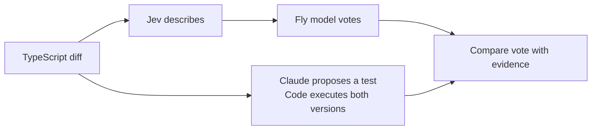

# fly-review

**Real fly wiring. Questionable judgment. Executable evidence.**

Would you merge code reviewed by a fruit fly?

fly-review gives a connectome-based neural simulation a vote on a TypeScript diff. It has **176,422 simulated neurons and zero code-review training**. Then an independent investigator proposes a test, and ordinary code checks whether the vote deserves to be believed.

**Jev describes. The fly model votes. Tests check.**

[Run it](#run-it) · [Try these changes](#try-these-changes) · [Is the brain real?](#is-the-brain-real) · [Inspect the evidence](#inspect-the-evidence)

## The 30-second version

> Jev reads a code change and turns four properties into input signals. Those signals run through a simulation built from real fruit-fly wiring. We map the resulting activity to a review verdict. A separate AI proposes a test, and code executes it against both versions. The fly doesn't understand TypeScript. It supplies the vote.

The entertaining part is the reviewer. The useful part is **turning a review claim into an executable test instead of accepting another confident opinion**.



The investigator receives the diff and its contract, **not the fly's verdict**.

## Run it

Requires **Node.js 24+**. For the full live flow, you'll also need API keys for [TypeSafe](https://docs.typesafe.ai/) and [Anthropic](https://console.anthropic.com/).

From the project directory:

```sh
npm install
npm run setup

# Keep existing credentials if you've already configured the project.
test -f .env || cp .env.example .env
```

Add your keys to `.env`:

```dotenv
TYPESAFE_API_KEY=your-typesafe-key
ANTHROPIC_API_KEY=your-anthropic-key
```

Then:

```sh
npm run demo
```

Open **http://localhost:4488**.

1. Choose a change and click **Ask the fly**.
2. Watch the measured neural activity play back in 3D and reveal its vote.
3. Click **Was the fly right?** to execute an independent investigation.

Setup verifies and downloads the approximately **23 MB connectome**, compiles the neural bridge, and exports the visualization's anatomy. It uses an existing JDK 21+, or downloads a project-local JDK on macOS/Linux arm64/x64. On other platforms, install JDK 21+ and set `JAVA_HOME`. Nothing is installed globally.

The neural simulation runs on your CPU. No CUDA, Python, or specialized AI GPU is needed. The browser uses native WebGL, with a labeled 2D fallback if WebGL is unavailable.

### Keys, costs, and configuration

| Action | What it uses |
|---|---|
| Ask the fly | One paid TypeSafe request, then a local neural simulation |
| Was the fly right? | One paid Anthropic request, then local code execution |
| Replay, disconnect, or rerun saved signals | No model API calls |
| Tests and neural calibration | No API keys required |

Defaults are `jev-latest` and `claude-haiku-4-5`. Override them with `TYPESAFE_MODEL` and `ANTHROPIC_MODEL`. Set `PORT` to change the local server's port.

Without a TypeSafe key, live Jev is disabled. You can explicitly select **manual inputs** inside **Inspect this experiment**. That mode still runs the real neural simulation, but **does not interpret the code**. It is visibly labeled; there is no silent mock fallback. The independent investigator still requires its Anthropic key.

## Try these changes

The dropdown includes ten executable examples. Some of the best contrasts from two live trials per example:

| Change | Observed fly reaction | What the tests established |
|---|---|---|
| **Put the API key in the audit log** | No objection, twice | The returned log line exposes a fake demonstration key |
| **Give the fly's legs a proper variable name** | Changes requested, twice | No regression demonstrated |
| **Speedrun the rate limit** | Changes requested, twice | The first retry drops from 1,000 ms to 1 ms |
| **Let the agent approve its own tools** | One vote each way | Unapproved writes become allowed |
| **The cleanup job got ambitious** | No objection, twice | Fresh or pinned records can be selected for deletion |

Also included: token-expiry boundaries, stale search responses, and the original checkout rounding/refactoring examples.

These observations used live **Jev 1.13.0**, the same encoder and readout, and neural seed **7**. **They are not scripted reactions or guaranteed outcomes.** New Jev probabilities can change the vote. Replaying the exact saved probabilities and seed tests the neural simulation's reproducibility separately.

No thresholds were adjusted to make the fly look competent. None of the twenty live trials abstained, including the harmless rename. This is not an accuracy benchmark.

To repeat that measurement yourself:

```sh
npm run measure:examples
```

This makes **20 paid TypeSafe calls**, two per example, and saves the probabilities and measured responses to `.runs/example-reactions.json`. No cached or hand-picked feature values are substituted.

## Is the brain real?

**The simulation is real. The code-review interpretation is ours.**

| Layer | What actually happens |
|---|---|
| Wiring | A processed derivative of the published male fruit-fly CNS connectome supplies 176,422 neurons and 6,287,749 retained connections |
| Input | Jev supplies four descriptive probabilities, not an approve/reject answer |
| Activity | A local Java engine runs simplified leaky integrate-and-fire neurons over that graph |
| Vote | A fixed, untrained readout maps measured downstream activity to changes requested, no objection, or abstention |
| Verification | Claude proposes a concrete input; a separate runner executes both source versions and compares them with a contract-derived expected result |

The fly model never reads source code, understands a PR, or explains a defect. Jev provides semantic interpretation. The network contributes a computation. **There is no evidence that inserting it makes code review better.**

### What goes into the network?

Jev answers four independent questions about the change:

- Does it process outside input?
- Can it affect stored data?
- Does it depend on ordering or timing?
- Does it change externally visible behavior?

Each probability becomes a stimulation rate from **0 to 180 Hz**. The four channels drive fixed mixtures of gustatory, mechanosensory, and visual input populations, partitioned by neuron ID. No feature is assigned a biologically meaningful “database neuron” or a dedicated approval pathway.

Each trial starts from rest and runs **450 ms of simulated time**. After 200 ms of startup, ten 25 ms activity windows are recorded. The browser replays those measurements slowly; it does not invent a movie of neural reasoning.

<details>
<summary>The exact, deliberately untrained readout</summary>

Three measured population rates are normalized:

- `A = MN9 / 90` (feeding-related output)
- `B = DNg62 / 200` (grooming-related output)
- `C = DNp01 / 480` (escape-related output)

The objection score is `(B + C) / max(0.001, A + B + C)`.

- Total raw output below 20 Hz: **abstain**.
- Otherwise, score ≥ 0.65: **changes requested**.
- Otherwise: **no objection**.

These meanings and thresholds are engineering choices, not biological facts. The score is **not a probability that the code is buggy**. The whole changed hunk is the review target; no line-level causal attribution is fabricated.

The neural configuration uses 0.5 ms steps, synaptic gain 0.65, exponential synapses, Kenyon-cell input gain 0.25, and one integration thread. The underlying engine is vendored unchanged; this project's Java bridge supplies stimulation and records measurements.

</details>

## Make it prove something

A review comment is a hypothesis, not evidence.

The investigator proposes a typed input and an expected result. The harness checks the input domain, computes its own expected value from the example's contract, and runs **both the original and changed functions**. It also runs a case-specific deterministic sweep. A model's incorrect expected value does not become the test oracle.

| Result | Meaning |
|---|---|
| **Confirmed** | A valid input satisfies the original contract but fails after the change |
| **Unsubstantiated** | No regression was demonstrated in the executed cases; this is not proof of correctness |
| **Inconclusive** | The original baseline could not be established against the contract |

For example, the fake-key logging change has a directly reproducible failure:

```text
Input:     formatAuditLine("alice", "DEMO_KEY_A")
Expected:  "user=alice"
Original:  "user=alice"
Changed:   "user=alice key=DEMO_KEY_A"
```

In live trials, the fly raised no objection. Execution established the leak anyway.

**Copy the regression test** gives you a runnable assertion. A confirmed regression's test intentionally fails against the changed implementation.

## Inspect the evidence

The main view stays simple. **Inspect this experiment** exposes the actual Jev questions and probabilities, stimulation rates, neural measurements, readout, test code, model rationale, and event log.

The experimental controls are real operations:

- **Does the brain actually matter?** keeps the signals and random seed fixed, disables synaptic transmission, and measures the outputs again. Losing the downstream response demonstrates network participation, not understanding.
- **Rerun the exact saved inputs** performs a fresh neural simulation and compares the recorded data, excluding wall-clock time.
- **Replay / pause / scrub** inspect the measured time bins without another API call.

Each review writes a local evidence bundle:

```text
.runs/review-…/
├── before.ts
├── after.ts
├── tool-policy.ts       # Case-specific changed filename
├── regression.test.ts   # Created after investigation
├── events.jsonl
└── review.json          # Inputs, neural recording, vote, and verification
```

To reproduce the saved assertion:

```sh
node .runs/review-<run-id>/regression.test.ts
```

### What the 3D view shows

The WebGL scene displays **6,087 real neuron-body positions** and **1,600 sampled actual connections**. The full retained network still runs in the simulator. Connection records preserve neuron IDs and synapse counts for inspection.

Drag or use arrow keys to rotate; `+`/`-` zoom; `0` resets the camera. Pause orbit to hold a view. Reduced-motion preferences disable automatic movement and skip animated playback.

Bright points are sampled neurons that fired in the displayed window. Camera movement is not activity. Connection lines are straight, schematic segments between cell bodies, **not reconstructed axon shapes**. Incoming signal graphics are explanatory diagrams, not recordings of individual synaptic events.

## Scope and safety

- **A bounded review lab, not a GitHub bot.** Ten bundled TypeScript diffs have explicit contracts and argument domains. There is no arbitrary-repository integration or automatic merge.
- **No real destructive side effects.** Tool approval, deletion, retries, and logging are tested through pure decision/formatting functions. This lab does not execute unapproved tools, delete records, hammer an API, or expose real credentials.
- **A simplified neural model, not a complete digital fly.** There is no code-review training, synaptic learning, biological validation of this application, or claim of consciousness.
- **Not a hostile-code sandbox.** The evaluator uses a timed, permission-restricted child process and VM for the bundled examples. Arbitrary submitted programs require proper OS/container isolation.
- **A local server with remote model calls.** Jev receives the selected diff, caller context, and contract. Anthropic receives the diff, contract, and parameter definitions, but not the fly vote. The connectome and neural computation stay local. Keys stay server-side; `.env` and recorded runs are ignored by Git.
- **One shared experiment per server.** The server binds to loopback and accepts same-origin JSON actions. It is not a multi-user production service. API failures stop the operation instead of fabricating results.

## Develop and verify

| Command | Purpose |
|---|---|
| `npm run setup` | Obtain/verify the connectome, compile the Java bridge, export anatomy |
| `npm run demo` | Build the browser client and start the local app |
| `npm run dev` | Same local development entry point |
| `npm run build:web` | Compile the TypeScript browser client |
| `npm run typecheck` | Check server, bridge client, and test types |
| `npm test` | Run offline unit and integration checks |
| `npm run calibrate` | Run real neural assays: varied signals, all readout classes, repeatability, and ablation |
| `npm run measure:examples` | Measure two live Jev/neural trials per example; requires a funded TypeSafe key |

`npm test` needs installed dependencies but no API keys or connectome download. Calibration requires setup but no paid model calls. Its results establish computational behavior, **not code-review accuracy**.

The implementation is TypeScript and native browser APIs, plus three vendored Java engine classes:

| Location | Responsibility |
|---|---|
| `src/review-cases.ts`, `src/review-oracles.ts` | Diffs, argument domains, independent expected results, test sweeps |
| `src/review-jev.ts`, `src/review-show.ts` | Feature extraction and experiment orchestration |
| `src/review-brain.ts`, `brain/ReviewBrainBridge.java` | Neural process boundary, recordings, and vote readout |
| `src/review-verify.ts`, `src/review-evaluate-worker.ts` | Blind investigator and independent execution |
| `web/` | Three-step interface and native WebGL viewer |

## Data, engine, and credit

The data derives from **[male-cns:v1.0](https://male-cns.janelia.org/)**, produced by the FlyEM team at HHMI Janelia, the University of Cambridge / MRC Laboratory of Molecular Biology, and Google Research, under **[CC BY 4.0](https://creativecommons.org/licenses/by/4.0/)**.

The processed dataset and unchanged `Connectome`, `LifConfig`, and `LifNetwork` classes come from [XprismDev/FlyBrainMC](https://github.com/XprismDev/FlyBrainMC), pinned to revision `d91f06ab812333c0d1bd79da1fc29e34bf383163`. Its simulator code is **MIT-licensed**; the original [license](vendor/flybrain/LICENSE) is retained.

This derivative keeps connections with at least five synapses and removes autapses, retaining approximately **72% of the source's neuron-to-neuron synapses**. It is not the unfiltered connectivity graph. The model follows the simplified approach of [Shiu et al., *Nature* (2024)](https://doi.org/10.1038/s41586-024-07763-9); that does not validate this application as a biological model of code review.

The connectome download is pinned by SHA-256:

```text
e33df182bed7a6f3ea279daf4790a82b05706d3d41e819a6a80c0473e8c559f3
```

See [the full provenance record](vendor/flybrain/PROVENANCE.md) for transformations, source queries, and attribution. fly-review is not affiliated with or endorsed by the dataset's producers.

**The fly gets a vote. Evidence gets the last word.**
